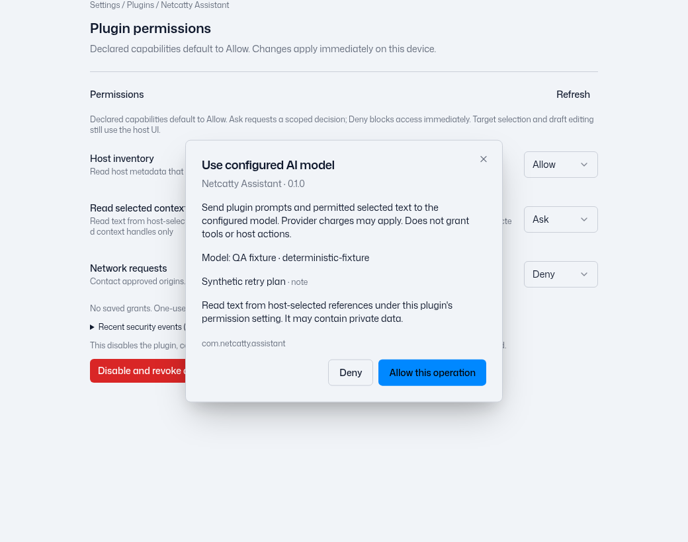
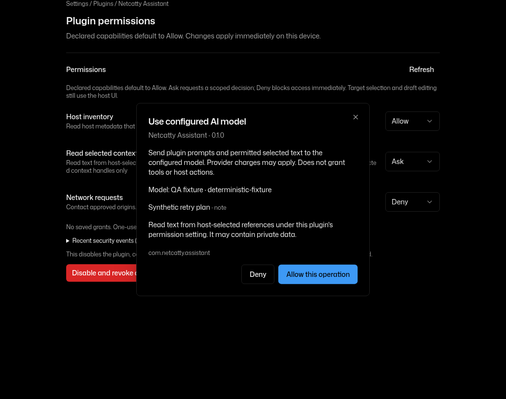
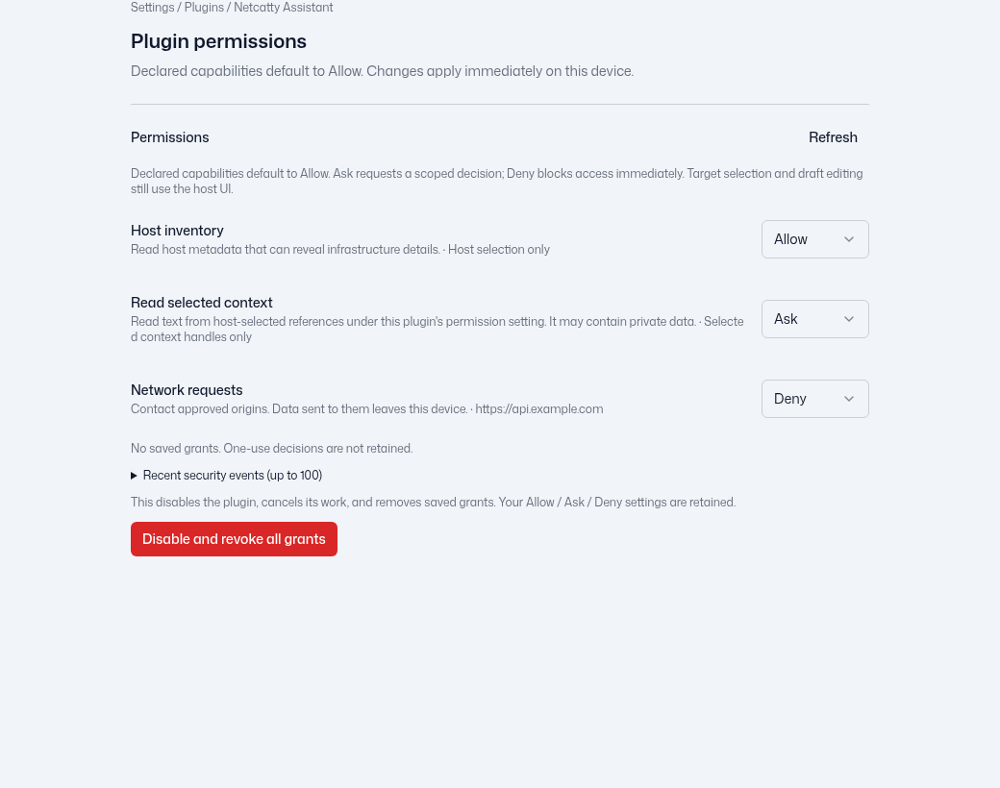
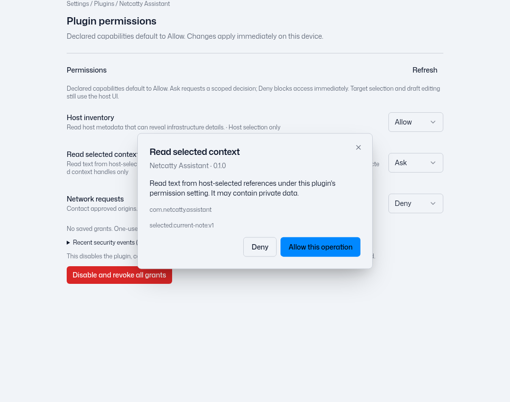
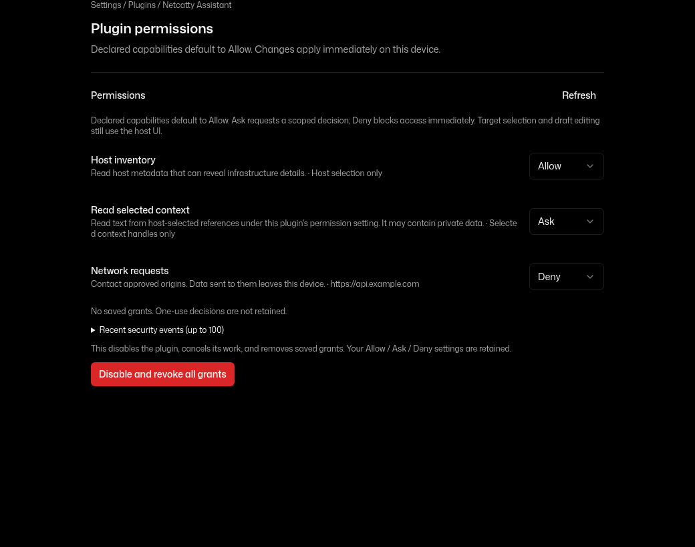
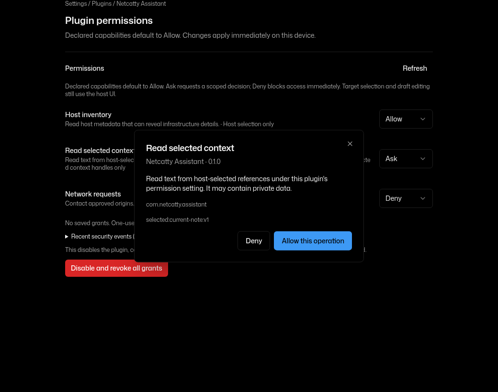

# Plugin Allow / Ask / Deny handoff

This change is stacked on frozen PR #3997 at
`677aac33b1eec9dbd4a367417a49c964cdea63e7`. Its source checkout and native QA
checkout were not changed. No merge, release, live database connection, native
activation or real user configuration change was performed here.

## Behavior and storage

- Declared supported capabilities default to Allow, with no installation
  checklist or required-permission preflight dialogs.
- Settings uses existing `SettingRow` and Select components. It shows each
  declaration's resource scope and effective Allow / Ask / Deny mode.
- Policies use `plugin_host_preferences`, keyed by host source owner and
  capability. They survive restart and updates within the same source, including
  reintroduced capabilities. New capabilities default to Allow. Existing grants
  still use the original package/declaration principal; they were not widened.
- Explicit source reset clears that source's policies and private plugin data.
  Another source receives independent defaults. Unrelated Vault, host, settings
  and user data are preserved. No plugin-policy migration was added.
- Policy edits clear grants, cancel pending/in-flight work and invalidate
  handles. Settings edits require the exact host-issued source/version/policy
  revision, so stale controls cannot change a replacement source or override a
  newer Deny.
- Ask decisions use the existing in-app Dialog/Button components, reached only
  through trusted managed-app-window preload IPC. A one-use response token binds the
  request; close, cancel, lock, blur/hide, reload, renderer crash and shutdown
  invalidate it. Plugin DOM clicks confer no host gesture authority.
- Host selection, model/context selection and draft editing remain workflows.
  Ask is integrated into their existing host UI where applicable. Allow removes
  permission-only sharing and connection confirmations while retaining exact
  target validation and action tokens. Terminal drafts never send PTY input.
- AI start combines model permission and exact selected-content scopes into one
  Ask decision. Its receipt cannot cross an RPC operation. Broker-bound stream
  reads/stop/close do not ask per chunk. Same-origin network redirects reuse the
  current operation decision; different origins still require declared bounds
  and their own authorization.
- Policy edits, decisions, use/revoke and operation outcomes remain auditable.
  Audit records omit note/terminal bodies, model payloads, credentials and tokens.
  Optional local log persistence remains user-controlled.

See [the security boundary](security-and-permissions.md) for the storage and
update rules. The separate AI cold-start provider-sync fix is not included;
`configuredModel.ts`, `trustedHostRuntime.ts` and `usePluginAIContextHost.ts`
were left untouched for parent integration.

## Review corrections after the initial 643e71b checkpoint

The initial commit and its screenshots remain in history. Registered regressions
reproduce three concrete issues on that exact tree and pass with these repairs:

- Selected-summary Ask now delegates its decision to the existing host chooser.
  The first and only interaction is target selection; Allow uses that same
  necessary chooser, while Deny opens none and releases no summaries.
- The registry creates a fresh host-only operation identity for every RPC.
  Internal model contexts retain it when replacing a cancellation signal, so a
  combined model/content Ask receipt survives that derivation. Receipts also
  bind plugin, runtime, source, principal and policy revision, and cannot cross
  operations. Current declaration, policy and selection checks still run.
- Changing the privileged development-only `runtime.advanced` policy to Ask or
  Deny disables/stops the activation through the existing manager mutation queue
  before the policy IPC completes. A source-owner check inside that queue prevents
  an old source's teardown from disabling a replacement. Browser sandbox policy
  and development admission guards remain unchanged.

Ask now presents the current host-selected model label and Note title/scope.
Exact versions remain bound internally. Labels come from the checked broker chat
and owned selected summaries;
plugins cannot supply operation identities or display fields through RPC params.
Opaque selected handles remain internal, and display metadata is not added to
audit records. The chooser copy reflects Allow / Ask / Deny without claiming a
mandatory second text review. Spanish keys preserve the existing locale parity
contract. The quota and expiry regression now uses independent requests to avoid
its former 20ms timer race.

Updated component previews use a realistic opaque selected handle internally:

| Light Ask | Dark Ask |
| --- | --- |
|  |  |

These remain synthetic Chromium component previews, not native QA or a recording.
No Library item was created. The original four screenshots below are retained as
initial-checkpoint evidence.

## Latest checks and remaining environment blockers

- The native candidate `2433cf0130d1c3274c56c39e5765349c2945de01` retains the
  same idle logging-row marker as `89beeb9` (source blob
  `4dd5a7cea4ae5a6addc5db5c162038d8fa44075c`). Actual Settings landing plus the
  existing observer reproduces native-child suppression with no dialog open.
  This source defect is separate from the worker's earlier GPU exit and does
  not alone establish the cause of the recorded blank native body.
- The scoped correction removes only the idle-row marker. Actual logging and
  Ask dialogs remain marked. A real nested verbose confirmation test also
  reproduced premature restoration when its parent became accessibility-hidden;
  that confirmation now opts into the existing marker on its own dialog content.
  The observer, window trust, permissions and data access are unchanged. The real
  landing regression verifies idle visible, each security dialog hidden, and
  restored on dismissal. Focused group **six passed**; Settings boundary group
  **36 passed**. Both pre-fix failures are retained outside the source tree.
  Production build and full lint pass (zero lint errors/seven existing warnings).
  Full TypeScript remains baseline-equivalent at 774 diagnostics with zero
  added/removed. Exact-head CI and the next frozen native recheck are separate
  gates; neither is inferred from these local tests.
- QA-only **Settings Ask QA 0.1.0** uses its supported `location: settings` entry
  and public SDK to read only its synthetic own setting after an explicit click.
  Exact archive SHA-256:
  `9502a58a4804862e4b13de9fc0d1baf6ad8c2bc681c08b5c0664b552ef0aafc4`.
  Its HTML/CSS/JS each return 200 with proper MIME/CSP through the actual plugin
  protocol. It contains no raw IPC/test hook or external access. No GUI or running
  app was changed by this correction; parent will build a new frozen candidate
  after current cleanup and repeat native Settings acceptance.
- A registered regression reproduces `Plugin permission decision provider failed`
  on exact `79a9bd6` when a Settings-owned view activates a real `settings.get`
  API configured Ask while main is unfocused. The follow-up uses the existing
  managed-window registry (including Settings), per-renderer readiness and the
  same in-app component. It does not focus main or expand plugin-frame trust.
  The actual Settings factory, installed package/SDK activation, view command
  IPC and permission IPC now pass main/Settings/foreign/background, subframe,
  independent readiness and hide/close/stale-token checks. Native Electron
  objects are represented in this regression; this is not native GUI acceptance.
  Focused boundary group: **67 passed**; renderer/native-view visibility group:
  **three passed**; runtime aggregate: **695 passed/one native skip**. The initial
  renderer assertion incorrectly expected a view to reappear while the separate
  permission-settings security surface remained visible; the corrected test
  checks both overlapping surfaces and restoration after both close.
  Production build passed (69 seconds). Full lint passes with the same seven
  warnings after moving a leftover screenshot harness out of the source tree;
  its initial lint failure is retained. TypeScript remains baseline-equivalent
  at 774 diagnostics, with zero added/removed after path normalization.
- Subsequent exact `da4e809` workflows **40444934631** (tests) and
  **40444934738** (packages) passed. The full suite reports **15,392 tests:
  15,342 passed, 50 skipped, zero failures/cancellations**. The runtime group
  reports 694 passed/one native skip, and package settings 35 passed. All four
  platform package jobs passed; release jobs were skipped. This does not replace
  manual plugin native acceptance or erase the local failures below.
- A focused wording follow-up removes the implication of mandatory prompts from
  the package detail's sensitive/unbounded scope text in English, Spanish,
  Russian and both Chinese locales. The Russian declaration note now also
  reflects default Allow instead of pre-activation permission ceremonies.
  The complete local CI boundary command passes after this copy change:
  contract generation is current, runtime 694 passed/one skip, examples five
  passed/one skip, and package settings 35 passed. Locale parity six passed;
  changed-file lint has no errors/warnings.
- Exact `2eee561` packaging workflow **40443396402 passed** on Linux x64,
  Linux arm64, macOS and Windows; release jobs were skipped. Its first Linux
  test job **121988800130** stopped on a runner shutdown signal, with no observed
  assertion failure. Parent requested one retry. Fresh job **121992430185**
  passed the 694-test runtime aggregate (one native skip) and failed two
  package-detail assertions still expecting the superseded "not a grant" copy.
  The full suite was skipped. Those assertions now verify default Allow,
  adjustable Ask/Deny and retained host/resource validation; development-runtime
  disclosure and HTML escaping remain checked. No production behavior changes
  accompany this test correction. Original interruption/failure logs are kept.
- Registered runtime recheck: **695 tests, 694 passed, zero failed/cancelled, one
  native skip**. Separate final registered receipt/authority group: **21 passed**.
- Serial mounted renderer/Host/selected-summary/panel/locale group: **35 passed**.
  A preceding concurrent run timed out during build/lint load; its failure log is
  retained. No timeout result is reclassified as a pass.
- Advanced-runtime manager/source lifecycle and AI group: **35 passed**.
  Receipt/declaration group: **32 passed**. Final engine/registry/manager/host
  boundary group: **71 passed**. Final registered AI audit/receipt check: **one
  passed**; an earlier 15-second timeout while the preview was active is retained.
  The serial rerun passed in five seconds. Contract/SDK/CLI: **91 passed**.
- Final production build passed in **45 seconds**. Full lint has zero errors/seven
  existing warnings. Full TypeScript remains **774 diagnostics**, identical to
  frozen 677 after path normalization, with zero added/removed diagnostics.
- The normal official Electron installer succeeded using its documented proxy
  support and a task-local cache. Exact **42.11.12** executes in Node mode; no
  shared libraries are missing. This is not native GUI acceptance.
- Exact-header setup via the installed node-gyp 12.4.0 and the unchanged rebuild
  tool's official URL failed. The proxy returns **403 Forbidden** for
  `https://www.electronjs.org/headers/v42.11.12/node-v42.11.12-headers.tar.gz`.
  That download stopped; no mirror, alternate host, checksum bypass, dependency
  shim, native-rebuild skip, HOME change or sandbox change was used. Normal
  postinstall/native rebuild and desktop packaging remain incomplete.
- A private task-local `TMPDIR` uses Netcatty's existing safe-temp resolution to
  its normal `Netcatty` subdirectory; HOME remains unchanged. This fixes the
  earlier fallback-to-unwritable-home prerequisite without changing app code.
- A **diagnostic full-suite run on the evolving worktree**, after those environment
  repairs, reported **15,059 tests: 14,922 passed, 92 failed, two cancelled, 43
  skipped**. A stuck FIDO child was terminated after its timeout; this is not a
  successful completed exact-head aggregate. Frozen-baseline focused runs
  reproduce its FIDO timeout and **28 failures** across native imports, Cursor
  fixtures and repository postinstall patch checks, plus the earlier six
  Markdown comparison assertions. Other failures remain unclassified. The
  permission locale parity and obsolete forced-review expectations found by that
  run were corrected and pass focused checks. Original failed/incomplete runs
  below are preserved.

The independent AI cold-start production files remain untouched. This branch
updates only policy expectations in `components/PluginAIContextHost.test.tsx`;
parent integration must retain the AI owner's actual-main-allowlist and provider
sync assertions when merging that test file.

## Local evidence

These are local code/test results, not native acceptance:

| Check | Result |
| --- | --- |
| Registered runtime aggregate, concurrency 2 | 693 tests: 691 passed, one failed, one native skip; no cancellations. Sole failure imports the missing Electron binary on real worker reconnect. |
| Engine, policy matrix, trusted prompt and policy IPC group | 79 passed; subsequent shutdown guard test: 9 passed. |
| Mounted in-app permission controls and Host/terminal workflows | 22 passed. Includes Host Allow/Ask/Deny, policy change during save preparation, exact targets and stale replies. |
| Registered AI/context + policy group | 7 passed, including normal Allow, combined Ask, Deny and revocation. |
| Source/version/revision edit guards and registered byte-stream group | 47 passed. |
| Contract/SDK/CLI suite | 91 passed. Four prepared sample archives validate. |
| Lint | Zero errors, seven existing warnings. |
| Production build | Passed; final `pack:dir` build also passed in 76 seconds. |
| Contract/capability/Codex generation | Regenerated/checks clean; no capability-tool diff. |
| Full TypeScript check | Frozen baseline and implementation each have 774 diagnostics; zero added/removed after normalizing worktree paths. |
| Full `npm test` | Incomplete: stopped after three unchanged bridge child processes remained pending. Reported 9,891 tests, 9,359 passed, 40 failed, 478 cancelled, 14 skipped. This is not a passing aggregate. |
| Desktop `pack:dir` | Unpassed: native rebuild attempts `/home/agent/.electron-gyp`, outside this workspace's writable roots. Earlier pinned Electron installation failed with `fetch failed`. No shim, alternate runtime or sandbox change was used. |

Frozen-baseline focused runs reproduce the two large-history SFTP recovery
failures, six Markdown comparison failures, and missing-Electron adapter/serial
failures observed in the broad run. Other broad-run failures remain unclassified;
unchanged code alone does not prove a baseline failure. One earlier runtime
aggregate hit the existing 15-second byte-stream fixture timeout during concurrent
builds; its focused run and the final aggregate above pass that case.

Logs and archives are in `/workspace/permission-evidence/` in this execution
environment. The final task report identifies any remaining blockers and checks.
Exact-head CI and native acceptance remain pending parent coordination.

## Component screenshots

Chromium rendered the actual React components with built-in light/dark tokens
and synthetic host bridge data. These images demonstrate layout and state only;
they do not certify Electron behavior.

| Controls | Ask |
| --- | --- |
|  |  |
|  |  |

## Prepared sample packages

All packages were built locally; none was activated in a native app. No owned or
public database service was contacted. The owned database package is scoped to
the previously specified disposable fixture endpoint `tcp://10.77.0.20:3306`.

| Archive | SHA-256 |
| --- | --- |
| assistant.ncpkg | `c7d784d5c3bd2feb463afd58eae3a9594615395b168174cb8a3d0677584ae395` |
| host-actions.ncpkg | `cf04f82dfe25ab5cda6f5f3dad0a8fb06c37bedf9924f556bee2b8402e542ef2` |
| terminal-selection-draft.ncpkg | `4c9c2388b7f891156192a0b5ab7b23291beba3555e7ec8cf24fbe2dfe1242d5e` |
| database-owned.ncpkg | `f01c6a24382897d4b0bf4130941274abacb9a9a963f9b56ecaceb2c020f36874` |

Reproduction uses the unchanged sample build tools:

```sh
node examples/plugins/assistant/build.mjs
node packages/plugin-cli/dist/cli.js pack examples/plugins/assistant/.package --out /tmp/assistant.ncpkg
node packages/plugin-cli/dist/cli.js pack examples/plugins/host-actions --out /tmp/host-actions.ncpkg
node examples/plugins/terminal-selection-draft/prepare.mjs /tmp/terminal-selection-draft.ncpkg
node examples/plugins/database-minimal/prepare.mjs tcp://10.77.0.20:3306 /tmp/database-owned.ncpkg
```

## Parent-serialized native recheck

1. Use a fresh isolated app profile and the exact next integrated head. Import and
   enable a sample: no installation permission ceremony should appear.
2. In Allow, select hosts in the host chooser, create/edit via the normal draft
   editor, and connect using a current selected reference without a separate
   plugin confirmation. Ordinary SSH authentication and host-key checks remain.
3. Select a Note/context and model, start and read a turn in Allow. Then switch
   AI/content to Ask: one scoped decision covers the turn and exact references,
   with no per-chunk or second content-sharing dialog.
4. Check terminal Allow sharing and the editable inert draft; Ask shows one share
   preview; Deny releases no selection and cannot reopen old handles.
5. Check network Allow/Ask/Deny at the declared endpoint. Preserve all endpoint,
   DNS, redirect, private-network and control-plane rejection checks.
6. Flip policy while a chooser, draft, model read or network operation awaits.
   Old results/tokens must fail. Switch back to Allow and start a fresh operation.
7. Restart/update the same source with an explicit Deny; it must remain Deny.
   Check distinct plugins and sources, stale settings edits and explicit source
   reset. Review bounded audit events and optional local logging for redaction.
8. Open a plugin view from standalone Settings and exercise an Ask-gated API
   during activation and from its own view command. Ask must be reachable in
   Settings without focusing main or losing the view. Close/hide/reload that
   window, switch to an unrelated window, and try a stale response: old authority
   must be cancelled, with no background-window fallback or plugin-frame reply.

No merge, release or native acceptance is authorized by this handoff.
